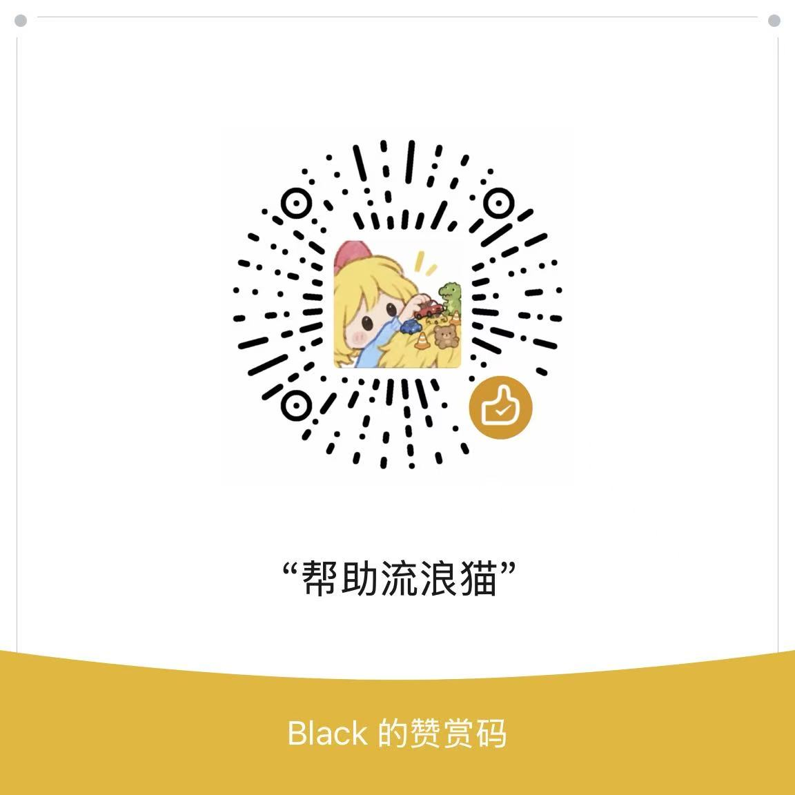

# Best-PaperWriting：计算机顶会/顶刊论文写作与学术绘图 Agent Skill

[](skills/top-tier-paper-writing/SKILL.md)
[-blue.svg)](https://agentskills.io/specification)
[]()

`top-tier-paper-writing` 是一个通用的 **Agent Skill**：一个包含 `SKILL.md`、脚本与参考资料的文件夹，遵循开放的 Agent Skills 格式，可直接被 **Claude Code、OpenAI Codex、Google Antigravity（App 与 CLI）** 等编码 Agent 加载。

它从“发表过多篇顶会/顶刊的资深博士生与审稿人”视角，覆盖计算机论文（CCF-A 会议、IEEE/ACM Transactions）的完整生命周期：

1. **领域识别**：识别论文所属领域（安全、系统、机器学习、NLP/LLM），补齐该领域必备章节与图表；
2. **学术绘图**：现代简约架构图（带圈步骤编号 ①–⑥）与实验图（Okabe-Ito 色盲友好配色、单/双栏 3.4 / 6.9 in）；
3. **Caption 规范**：图用 Sentence case、表用 Title Case，Caption 不下结论；
4. **正文写作**：引言“双挑战—双案例—双直觉”，实验段落“总—分—归因”，拒绝报菜名；
5. **双栏排版**：浮动体三大铁律，配套 `floatcheck.sty` + `check_layout.py` 自动检查；
6. **句式库扩充**：从优秀范文中萃取因果归因句式，人工审核后写入；
7. **修订与投稿**：补实验后全文回溯、参考文献多源核验、arXiv 版本与期刊扩展投稿。

完整规范见 [`skills/top-tier-paper-writing/SKILL.md`](skills/top-tier-paper-writing/SKILL.md)。

---

## 一、安装

Skill 只有一份源文件：`skills/top-tier-paper-writing/`。安装脚本把它**链接**（默认）或**复制**到各 Agent 读取 Skill 的目录：

```bash
git clone https://github.com/yujiew012/Best-PaperWriting.git
cd Best-PaperWriting
python3 install.py                       # 为所有支持的 Agent 安装到用户目录
python3 -m pip install -r skills/top-tier-paper-writing/requirements.txt
```

安装后重启 Agent，让它重新扫描 Skill。常用选项：

```bash
python3 install.py --agent claude codex          # 只装给部分 Agent
python3 install.py --project /path/to/paper-repo # 装到某个论文项目里（可随项目提交）
python3 install.py --copy                        # 复制而不是链接（如 Windows 无法创建符号链接）
python3 install.py --dest /any/skills/dir        # 装到任意 skills 目录
python3 install.py --status                      # 查看安装状态
python3 install.py --uninstall                   # 卸载（只删除本脚本装的内容）
```

| Agent | 用户级目录（默认） | 项目级目录（`--project`） |
| :--- | :--- | :--- |
| Claude Code | `~/.claude/skills/` | `.claude/skills/` |
| OpenAI Codex | `~/.agents/skills/`（旧版本读 `~/.codex/skills/`，可用 `--dest` 指定） | `.agents/skills/` |
| Google Antigravity App | `~/.gemini/antigravity/skills/` | `.agents/skills/` |
| Google Antigravity CLI | `~/.gemini/antigravity-cli/skills/` | `.agents/skills/` |

- 默认使用符号链接，所有 Agent 共用同一份文件，`git pull` 后立即生效；用 `--copy` 时更新需重新运行安装。
- 各工具的目录约定仍在变化，如果你的版本读取其他位置，用 `--dest` 指定即可；安装后可在 Agent 中确认（Claude Code 和 Codex 用 `/skills`，Antigravity 看 Customizations 面板）。
- **其他 Agent**（不支持 Skill 的工具，如部分 IDE 助手）：`SKILL.md` 是普通 Markdown，可在项目的 `AGENTS.md` 或规则文件中写一句“写论文时先阅读 `<path>/top-tier-paper-writing/SKILL.md` 并按其中指引加载参考文件”。

### 使用

装好后，直接让 Agent 做论文相关的事即可，例如“帮我重写这篇论文的引言”“把这张实验表格写成分析段落”“检查一下 main.tex 的浮动体位置”。Agent 会根据 Skill 描述自动加载，也可以显式调用（Claude Code 中输入 `/top-tier-paper-writing`，Codex 中输入 `$top-tier-paper-writing`）。

---

## 二、Skill 的设计

Skill 按“可执行 SOP”组织，分三层加载，尽量少占 Agent 的上下文：

| 层级 | 内容 | 何时加载 |
| :--- | :--- | :--- |
| 1. 索引 | `SKILL.md` frontmatter：何时使用、**何时不要使用** | 始终（约 540 字符） |
| 2. SOP | `SKILL.md` 正文：总规则、人工确认关口、需求分流表、9 个分支（读取 → 执行 → 验证）、故障处理、完成标准（Definition of Done） | 触发 Skill 时 |
| 3. 资源 | `references/`（按章节拆分的写作规范、图表/排版/参考文献规则、检查代码表）、`assets/`（模板与示例数据） | 进入对应分支时 |

**确定性工作交给脚本**：统计量、图表尺寸、浮动体位置、标签与引用、参考文献字段都由脚本计算和检查，模型负责理解意图、选择分支、写作与综合。每个分支都以脚本检查作为完成标准，失败时按 `references/lint_rules.md` 修复并重跑（同一问题最多 3 次，之后向用户报告）。

**安全边界**：替换多段已有正文、删除章节/图表/文献条目、安装软件、写入句式库前必须征得用户同意；投稿、上传、发邮件只准备材料，不代替用户执行。

## 三、目录结构

```
skills/top-tier-paper-writing/
├── SKILL.md                      # 触发描述 + 精简 SOP + 完成标准
├── requirements.txt              # 不使用 uv 时的依赖（matplotlib、numpy）
├── EVOLUTION_LOG.md              # 句式库扩充记录
├── scripts/                      # 确定性脚本（均带 PEP 723 头，可直接 `uv run`）
│   ├── check_env.py              # 环境就绪检查（plot / layout / bib / lint / network）
│   ├── lint_paper.py             # .tex 静态检查：label/引用、Caption 大小写与结论、\vspace、模糊措辞、堆数字、摘要/结论长度
│   ├── result_stats.py           # 从结果 CSV 计算领先幅度、排名、区间、降幅，以及“未领先”的设置
│   ├── plot_data_curves.py       # 多种子曲线（均值 ± 标准差、敏感性最优点、两阶段分隔）
│   ├── plot_bar_ablation.py      # 分组柱状图（误差棒、相对完整模型的增量）
│   ├── gen_architecture_diagram.py  # 由 JSON 规格生成架构图（带编号步骤，自动检查重叠）
│   ├── pubstyle.py               # 共享绘图样式（尺寸、字体、Okabe-Ito 配色）
│   ├── check_figure.py           # 图 PDF 检查：宽度、Type 3 字体、矢量
│   ├── layout_check.py           # 一条命令：诊断编译 + 浮动体检查 + 基线对比
│   ├── check_layout.py, floatcheck.sty  # 浮动体位置记录与分析
│   ├── check_bib.py              # .bib 检查：重复、缺字段、未加括号的缩写、预印本、缺失引用
│   ├── domain_adapter.py         # 领域识别与领域配置
│   ├── self_evolve.py            # 从范文萃取候选句式（预览，确认后 --apply）
│   └── validate_skill.py         # 维护者：校验 Skill 打包
├── references/
│   ├── writing/                  # 按章节拆分：原则与句式、摘要/引言、相关工作/预备知识、方法/理论、实验、讨论/结论/伦理
│   ├── figures_and_captions.md   # 架构图、实验图、表格、Caption 规则与正反例
│   ├── layout_and_typesetting.md # 浮动体三条铁律、测量流程、修复阶梯
│   ├── bibliography.md           # 参考文献多源核验
│   ├── revision_and_submission.md# 补实验后回溯、arXiv 版本、期刊扩展
│   ├── domain_and_sentence_mining.md
│   ├── lint_rules.md             # 所有检查代码的含义与修复方法
│   ├── mechanism_sentence_bank.md, domain_taxonomies.json
│   └── case_lessons_ieee_sp.md, case_lessons_ieee_tcc.md  # 两篇真实论文的修改与投稿经验
└── assets/
    ├── prompt_templates.md       # “实验表格 → 分析正文”“架构图设计”提示词
    └── curves_example.csv, ablation_example.csv, architecture_example.json  # 输入格式示例（不可用于论文）
```

## 四、脚本速查

脚本既可以由 Agent 按 SOP 调用，也可以手动运行。推荐 `uv run`（按脚本头部声明自动准备隔离环境）；没有 uv 时用 `python3`，并先 `pip install -r requirements.txt`。

```bash
S=skills/top-tier-paper-writing/scripts

python3 $S/check_env.py                                          # 环境检查
uv run $S/lint_paper.py paper/main.tex                           # 正文静态检查
uv run $S/result_stats.py --data results.csv --ours "FedPE"      # 写实验分析前先算证据数字
uv run $S/plot_data_curves.py --data curves.csv --ours "FedPE (Ours)" \
    --xlabel "Communication rounds" --ylabel "Test accuracy (%)" --out fig_conv.pdf
uv run $S/plot_bar_ablation.py --data ablation.csv --ours "Full model" --annotate-delta --out fig_abl.pdf
uv run $S/gen_architecture_diagram.py --spec fig_arch.json --out fig_arch.pdf
uv run $S/check_figure.py fig_*.pdf                              # 宽度 / 字体检查
uv run $S/layout_check.py paper/main.tex --save-baseline before.json   # 改稿前
uv run $S/layout_check.py paper/main.tex --compare before.json         # 改稿后：变差则退出码为 1
uv run $S/check_bib.py paper/refs.bib --tex paper/main.tex
```

所有检查脚本：退出码 0 = 通过，1 = 发现问题，2 = 输入或环境错误；`--json` 输出机器可读报告。

---

## 五、维护约定

- 只修改 `skills/top-tier-paper-writing/` 这一份源文件；符号链接安装时，各 Agent 读取的就是它。
- 修改后运行 `python3 skills/top-tier-paper-writing/scripts/validate_skill.py`：检查 frontmatter（`name` 与目录一致、`description` 单行且不超过 1024 字符）、`SKILL.md` 提到的路径都存在、每个脚本都有 PEP 723 头并能编译、`references/` 与 `assets/` 中没有 SKILL.md 无法到达的文件。
- `SKILL.md` 只放流程、规则与完成标准（500 行以内）；细节写进 `references/`，并在对应分支的 **Read** 步骤中登记。
- 新增确定性检查时，写成 `scripts/` 中的脚本（带 PEP 723 头、`--json`、统一退出码），并把它的代码加入 `references/lint_rules.md`。

---

## 六、投喂流浪猫 🐱

如果这个 Skill 帮你少熬了几个改稿的夜，欢迎扫码请流浪猫吃顿饭。**所有赞助都将用于为流浪猫购买猫粮。**

If this skill saved you a few late nights of revisions, you can scan either code below to buy food for stray cats. **All sponsorship goes to cat food for stray cats.**

<table>
  <tr>
    <td align="center"></td>
    <td align="center"></td>
  </tr>
  <tr>
    <td align="center">微信支付 WeChat Pay</td>
    <td align="center">微信赞赏码 WeChat Reward</td>
  </tr>
</table>

谢谢你，也替猫咪们谢谢你！ Thank you, from us and from the cats!
