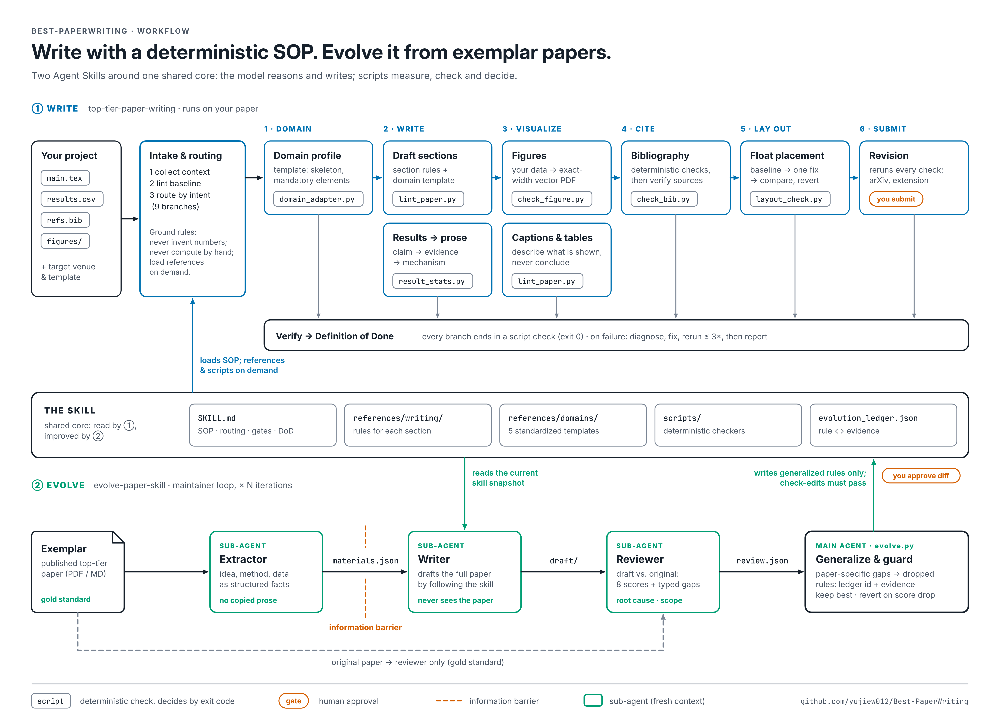

# Best-PaperWriting

**An Agent Skill for top-tier CS paper writing and academic figures**<br>
**计算机顶会/顶刊论文写作与学术绘图 Agent Skill**

[](skills/top-tier-paper-writing/SKILL.md)
[-blue.svg)](https://agentskills.io/specification)
[]()

**[English](#english)** · **[中文](#中文)**

<p align="center">
  
</p>

---

## English

`top-tier-paper-writing` is a general-purpose **Agent Skill**: a folder containing `SKILL.md`, scripts and reference material in the open Agent Skills format. **Claude Code, OpenAI Codex and Google Antigravity (app and CLI)** can load it directly.

Written from the perspective of a senior PhD researcher and reviewer with several top-tier publications, it covers the whole life cycle of a computer-science paper for CCF-A conferences and IEEE/ACM Transactions:

1. **Domain templates.** Identify the paper's area (security & privacy, LLM/agent security, federated learning algorithms, systems, NLP/LLM) and apply that area's standardized template: paper skeleton, mandatory elements, evaluation protocol.
2. **Academic figures.** Modern-minimal architecture diagrams with numbered steps ①–⑥, and data plots with the colorblind-safe Okabe-Ito palette at exact single- or double-column widths (3.4 / 6.9 in).
3. **Captions.** Case and content follow the venue: descriptive captions for IEEE/ACM/ACL/USENIX, takeaway-first captions for NeurIPS/ICML/ICLR.
4. **Prose.** Seven principles drive every section: tell one story (the 7W), clear structure with purpose paragraphs and topic sentences, old-to-new information flow, strategic placement, short sentences with the verb next to the subject, evidence in decreasing order of credibility, and data presented the way readers expect; a reverse outline (`outline.py`) and lint checks enforce them. Introductions are routed by paper type and motivation (method, capability, measurement, theory, dataset, ...), built from a claim map in which every claim has its evidence, its wording strength and exactly one paragraph; results paragraphs as claim → evidence → mechanism, never reading the table aloud.
5. **Checks against fabrication and machine prose.** Every number in the text is traced to a source file (`check_numbers.py`); boilerplate, workflow traces and exemplar reuse are flagged; abstract and introduction style is compared, in both directions, with a corpus of the paper's area; revisions come as a sentence-level change table, and every draft ships with an author report (claims, TODOs, figure plan, Limitations notes).
6. **Two-column layout.** Three rules for float placement, checked automatically with `floatcheck.sty` + `check_layout.py`.
7. **Self-evolution.** The companion `evolve-paper-skill` improves the skill from exemplar papers with three sub-agents (Extractor → Writer → Reviewer); an evidence ledger prevents overfitting. A figure mode evolves the architecture-diagram rules and per-domain diagram styles the same way (Figure Extractor → Illustrator → Critic). Held-out eval cases with a blind comparison against the published original measure whether a new skill version is actually better.
8. **Revision and submission.** Backward-consistency pass after new experiments, multi-source bibliography verification, arXiv versions and journal extensions.

See [`skills/top-tier-paper-writing/SKILL.md`](skills/top-tier-paper-writing/SKILL.md) for the full procedure and [`skills/evolve-paper-skill/SKILL.md`](skills/evolve-paper-skill/SKILL.md) for the evolution loop.

### 1. Installation

The repository contains two skills, each kept in a single source folder: `skills/top-tier-paper-writing/` (writing papers) and `skills/evolve-paper-skill/` (evolving the former from exemplar papers; for maintainers). The installer **links** (default) or **copies** them into each agent's skills directory. Use `--skill <name>` to install only one.

```bash
git clone https://github.com/yujiew012/Best-PaperWriting.git
cd Best-PaperWriting
python3 install.py                       # all supported agents, user level
python3 -m pip install -r skills/top-tier-paper-writing/requirements.txt
```

Restart the agent afterwards so it rescans its skills. Common options:

```bash
python3 install.py --agent claude codex          # only some agents
python3 install.py --project /path/to/paper-repo # inside one paper project (can be committed with it)
python3 install.py --copy                        # copy instead of link (e.g. Windows without symlinks)
python3 install.py --dest /any/skills/dir        # any other skills directory
python3 install.py --status                      # show what is installed where
python3 install.py --uninstall                   # remove only what this script installed
```

| Agent | User level (default) | Project level (`--project`) |
| :--- | :--- | :--- |
| Claude Code | `~/.claude/skills/` | `.claude/skills/` |
| OpenAI Codex | `~/.agents/skills/` (older versions read `~/.codex/skills/`; use `--dest`) | `.agents/skills/` |
| Google Antigravity app | `~/.gemini/antigravity/skills/` | `.agents/skills/` |
| Google Antigravity CLI | `~/.gemini/antigravity-cli/skills/` | `.agents/skills/` |

- Symlinks are the default, so every agent shares the same files and `git pull` updates them all. With `--copy`, rerun the installer after updating.
- Directory conventions still change between versions. If yours reads another location, use `--dest`. Confirm the installation inside the agent: `/skills` in Claude Code and Codex, or the Customizations panel in Antigravity.
- **Agents without skill support** (some IDE assistants): `SKILL.md` is plain Markdown. Add a line to the project's `AGENTS.md` or rules file such as "When writing a paper, first read `<path>/top-tier-paper-writing/SKILL.md` and load its references as it instructs."

#### Usage

Once installed, just ask the agent for paper work, for example "rewrite the introduction of this paper", "turn this results table into an analysis paragraph" or "check the float placement in main.tex". The agent loads the skill from its description. You can also invoke it explicitly: `/top-tier-paper-writing` in Claude Code, `$top-tier-paper-writing` in Codex.

### 2. Design

The skill is an executable SOP, loaded in three layers to keep the agent's context small:

| Layer | Content | Loaded |
| :--- | :--- | :--- |
| 1. Index | `SKILL.md` frontmatter: when to use it, and **when not to** | Always (about 540 characters) |
| 2. SOP | `SKILL.md` body: ground rules, human approval gates, routing table, 9 branches (Read → Do → Verify), failure recovery, Definition of Done | When the skill triggers |
| 3. Resources | `references/` (per-section writing rules, figure / layout / bibliography rules, checker codes) and `assets/` (templates, example data) | When a branch needs them |

**Venue-aware.** Pass `--venue` (`ieee`, `acm`, `acl`, `neurips`, `icml`, `iclr`, `usenix`, `lncs`, `elsevier`, `elsevier-cas`) and figure widths, caption case, required sections and the page budget follow that venue (`references/venues.json`).

**Deterministic work goes to scripts.** Statistics, figure sizes, float positions, labels and references, and bibliography fields are computed and checked by scripts. The model interprets the request, chooses the branch, writes and synthesizes. Every branch ends with a script check as its completion criterion. On failure the agent fixes the issue using `references/lint_rules.md` and reruns the check, at most 3 times per issue, then reports to the user.

**Safety boundaries.** The agent asks before replacing several existing paragraphs, deleting sections, figures or bibliography entries, installing software, or writing to the sentence bank. For submissions, uploads and emails it only prepares the material and never acts on the user's behalf.

### 3. Directory Layout

```
skills/top-tier-paper-writing/
├── SKILL.md                      # trigger description + concise SOP + Definition of Done
├── requirements.txt              # dependencies when not using uv (matplotlib, numpy)
├── EVOLUTION_LOG.md              # evolution history
├── evolution_ledger.json         # rule evidence ledger (maintained by evolve.py; never edit by hand)
├── scripts/                      # deterministic scripts (all with PEP 723 headers, runnable via `uv run`)
│   ├── check_env.py              # environment readiness (plot / layout / bib / lint / network; --venue: class files and fonts)
│   ├── lint_paper.py             # static .tex checks: labels/refs, caption case and conclusions, \vspace, vague wording, overclaiming, number dumping, lengths, venue-required sections
│   ├── result_stats.py           # margins, ranks, ranges, condition changes and the exceptions to report (method or measurement papers)
│   ├── plot_data_curves.py       # curves: mean ± std, small multiples, log/inverted axes, shaded regimes, two-phase split
│   ├── plot_bar_ablation.py      # grouped bars; paired before/after mode; error bars only for real variation
│   ├── gen_architecture_diagram.py  # architecture diagram from a JSON spec: numbered steps, actor glyphs, plot insets, image grids; exits 1 on any collision
│   ├── compose_examples.py       # grid of example inputs (clean vs. attacked) at the venue's width
│   ├── pubstyle.py               # shared plot style (sizes, fonts, Okabe-Ito palette)
│   ├── figstyle.py               # loads and bounds-checks the per-domain diagram style profiles
│   ├── check_figure.py           # figure PDF checks: width (per venue), Type 3 fonts, vector output
│   ├── layout_check.py           # one command: diagnostic build + float checks + baseline compare
│   ├── check_layout.py, floatcheck.sty  # float position recording and analysis
│   ├── check_bib.py              # .bib checks: duplicates, missing fields, unbraced acronyms, preprints, missing citations
│   ├── check_numbers.py          # fabrication check: every number in the prose traced to a source file
│   ├── claim_map.py, figure_plan.py, make_report.py  # claim map and figure plan validation; author report
│   ├── style_metrics.py          # abstract/introduction style vs. a corpus of the area (two-sided)
│   ├── change_table.py           # sentence-level change table for revisions
│   ├── outline.py                # reverse outline (topic sentences) and structure checks
│   ├── find_exemplars.py         # exemplar passages by rhetorical function
│   ├── domain_adapter.py         # domain detection and domain profile
│   ├── self_evolve.py            # candidate sentences from exemplar papers (preview; --apply after review)
│   └── validate_skill.py         # maintainers: validate the skill's packaging
├── references/
│   ├── writing/                  # seven principles; per section: principles & style, abstract/intro, related work/preliminaries, method/theory, evaluation, discussion/conclusion/ethics
│   ├── domains/                  # standardized domain templates (same 8 sections): security_privacy, llm_agent_security, machine_learning_fl, distributed_systems, nlp_llm
│   ├── figures_and_captions.md   # architecture diagrams, data plots, tables, captions, with good/bad examples
│   ├── figure_styles/            # per-domain diagram styles (<domain>.json: fonts, strokes, fills, role colours, topology) + _bounds.json
│   ├── layout_and_typesetting.md # the three float rules, measurement workflow, repair ladder
│   ├── bibliography.md           # multi-source bibliography verification
│   ├── revision_and_submission.md# backward consistency, arXiv versions, journal extensions
│   ├── domain_and_sentence_mining.md
│   ├── lint_rules.md             # every checker code, its meaning and its fix
│   ├── intake.md                 # what to ask before writing; revise mode
│   ├── style_corpus/             # style ranges: general reference + per-domain profiles built by evolution
│   ├── exemplars/                # function-tagged exemplar bank (filled by evolution)
│   ├── venues.json               # venue profiles: widths, caption case, required sections, page limits, class files
│   ├── mechanism_sentence_bank.md, domain_taxonomies.json
│   └── case_lessons_ieee_sp.md, case_lessons_ieee_tcc.md  # lessons from two real submissions
└── assets/
    ├── prompt_templates.md       # prompts: "results table → analysis prose", "architecture diagram design"
    └── curves_example.csv, ablation_example.csv, architecture_example.json  # input format examples (never for papers)
skills/evolve-paper-skill/          # for maintainers: evolves the skill above from exemplar papers
├── SKILL.md                      # orchestrator SOP: iteration loop, sub-agents, approval gates, Definition of Done
├── scripts/evolve.py             # deterministic orchestration: isolated workspaces, validation, leakage checks, scoring, keep/revert, ledger, anti-overfitting guards
├── scripts/figure_mode.py        # figure mode: brief checks, gold-figure cropping, coverage, style-profile ledger, feature requests
├── scripts/corpus_mode.py, eval_mode.py  # style ranges and exemplars; held-out eval cases with blind comparison
├── assets/agents/                # role task templates: extractor, writer, reviewer; fig_extractor, illustrator, critic
├── assets/schemas/               # contracts for materials, review, figure_brief and figure_review
└── references/                   # anti_overfitting.md (rule admission ladder), review_rubric.md (8 dims), figure_rubric.md (6 dims)
docs/
├── images/                       # workflow diagram, sponsor codes
└── diagram/                      # code that generates and checks the workflow diagram
```

### 4. Self-Evolution: Improving the Skill from Top-Tier Papers

Give the main agent one or more published top-tier papers. Following the `evolve-paper-skill` SOP, it runs three sub-agents for the number of iterations you choose:

```
            exemplar PDF / Markdown
                   │
        ┌──────────▼──────────┐   outputs structured facts only (idea, method, data, the paper's own names);
        │ ① Extractor          │   copied sentences are detected and rejected (> 16 words)
        └──────────┬──────────┘
          materials.json (title, authors, venue removed)
        ┌──────────▼──────────┐   never sees the paper: its workspace holds only the materials and the
        │ ② Writer             │   current skill; drafts the whole paper + a "skill friction" report
        └──────────┬──────────┘
             draft/main.tex
        ┌──────────▼──────────┐   original = gold standard: 8 scores + a list of gaps, each tagged with
        │ ③ Reviewer           │   a root cause (missing / vague / wrong rule, not followed, …) and a scope
        └──────────┬──────────┘
              review.json
        ┌──────────▼──────────┐   generalize → evolve.py propose (overfitting guard) → edit the skill
        │   Main agent         │   → evolve.py check-edits → next iteration; a score drop reverts automatically
        └─────────────────────┘
```

**Preventing overfitting is the core of the design.** The skill accumulates transferable conventions and never memorizes a specific paper:

| Mechanism | How it works |
| :--- | :--- |
| Domain templates | Knowledge goes into the fixed 8-section structure of `references/domains/<domain>.md`: skeleton, mandatory elements, evaluation protocol, figures, narrative patterns, common rejection reasons, provisional rules. |
| Evidence ladder | One paper can only add a provisional rule to §8 of its domain template. A second paper from the same domain makes it established. Universal rules (`SKILL.md`, `writing/`) need **at least 2 papers from at least 2 domains**. |
| Evidence ledger | `evolution_ledger.json` records each rule's scope and its supporting and contradicting evidence. Rules contradicted more often than supported are retired automatically. |
| Deterministic guards | An edit is refused if it contains the paper's method or component names, its result values, or 8 or more consecutive words from it. At most 40 added lines per iteration and 8 provisional rules per paper. Every added rule line must carry its ledger id. |
| Information barrier | The Writer never sees the original. A draft with too much verbatim overlap with the original is invalid. |
| Keep the best | The skill is snapshotted every iteration. If a new draft scores below the best earlier one (tolerance 0.25), the edits are reverted and their rules rejected. |
| Holdout check | Earlier exemplars (cached materials) confirm that new edits did not make older papers worse. |
| Human approval | You confirm the papers and the number of iterations up front, then review `report.md` and the `git diff` to keep the changes or `revert --to-base`. |

**Figure mode (architecture diagrams).** `evolve.py init --mode figure` withholds the paper's architecture or overview figure. A Figure Extractor writes a content-only brief: entities, roles, relations, numbered steps and groups, with layout and colour words rejected by the script. The script crops the original from the PDF. An Illustrator redraws the figure from the brief with the skill's generator and the domain's style profile, and a Critic that can view images compares the two on 6 dimensions (completeness, structure, flow, emphasis, domain conventions, visual quality). Each gap goes down one of three paths:

| Gap | Path |
| :--- | :--- |
| A figure rule is missing, vague or wrong | `propose`: the same evidence ladder as writing rules (domain §8 first) |
| A style value suits the domain badly (fonts, strokes, fills, role colours, topology) | `propose-style`: the script writes a value inside `figure_styles/_bounds.json` as a provisional override of `figure_styles/<domain>.json`; it moves into the base when a second paper agrees |
| The generator cannot draw it (icons, panels, curved edges) | `request-feature`: logged for a human; the loop never edits scripts |

The figure is judged on what it communicates, not on likeness to the original. A re-render with more layout issues, or lower coverage of the brief, is reverted regardless of the Critic's score.

Usage: tell the agent "evolve the paper-writing skill with these papers, 3 iterations" (or "evolve the figure skill with this paper's architecture diagram, 2 iterations"), and it loads `evolve-paper-skill` and follows the procedure. Paper text, materials and drafts stay in `.evolution/` (git-ignored) and never enter the repository.

### 5. Script Quick Reference

The agent calls these scripts as the SOP prescribes, but you can also run them yourself. `uv run` is recommended: it prepares an isolated environment from each script's header. Without uv, use `python3` after `pip install -r requirements.txt`.

```bash
S=skills/top-tier-paper-writing/scripts

python3 $S/check_env.py --venue acl --paper-dir paper/          # environment check (incl. venue class and fonts)
uv run $S/lint_paper.py paper/main.tex --venue acl               # static manuscript checks
uv run $S/result_stats.py --data results.csv --ours "FedPE"      # evidence numbers before writing the analysis
uv run $S/plot_data_curves.py --data curves.csv --ours "FedPE (Ours)" \
    --xlabel "Communication rounds" --ylabel "Test accuracy (%)" --out fig_conv.pdf
uv run $S/plot_bar_ablation.py --data ablation.csv --ours "Full model" --annotate-delta --out fig_abl.pdf
uv run $S/plot_bar_ablation.py --data defense.csv --paired "No defense" "With defense" --venue acl --out fig_def.pdf
uv run $S/gen_architecture_diagram.py --spec fig_arch.json --style <domain_id> --venue acl --out fig_arch.pdf
uv run $S/check_figure.py --venue acl fig_*.pdf                 # width / font checks for the venue
uv run $S/layout_check.py paper/main.tex --venue acl --save-baseline before.json   # before editing (+ page budget)
uv run $S/layout_check.py paper/main.tex --compare before.json         # after editing: exit 1 if worse
uv run $S/check_bib.py paper/refs.bib --tex paper/main.tex
```

All checkers use the same exit codes: 0 = pass, 1 = problems found, 2 = input or environment error. `--json` writes a machine-readable report.

### 6. Maintenance

- Edit only the source folders under `skills/`. With symlink installs, that is exactly what every agent reads.
- After changes, run `python3 skills/top-tier-paper-writing/scripts/validate_skill.py`. It checks:
  - the frontmatter: `name` equals the folder name; `description` is a single line of at most 1024 characters;
  - every path mentioned in `SKILL.md` exists;
  - every script has a PEP 723 header and compiles;
  - no file in `references/` or `assets/` is unreachable from `SKILL.md`.
- Keep `SKILL.md` to procedure, rules and the Definition of Done (under 500 lines). Put detail into `references/` and register it in the matching branch's **Read** step.
- New deterministic checks become scripts in `scripts/` (PEP 723 header, `--json`, standard exit codes), and their codes go into `references/lint_rules.md`.
- The workflow diagram is generated from code. After editing `docs/diagram/build_workflow.py`, run `python3 docs/diagram/build_workflow.py && node docs/diagram/render.js`. The renderer exports `docs/images/workflow.png` at 3× resolution and verifies that no text overflows and no elements overlap; it exits 1 otherwise.

### Acknowledgements

Paper-type routing, the claim map, two-sided style metrics, the figure plan, the exemplar bank and the held-out blind evaluation are adapted from [Best-Paper-Writing-Skill](https://github.com/gulucaptain/Best-Paper-Writing-Skill) (CC BY 4.0); `references/style_corpus/general.json` reproduces its published aggregate statistics (no paper text). See [`NOTICE.md`](skills/top-tier-paper-writing/NOTICE.md).

---

## 中文

`top-tier-paper-writing` 是一个通用的 **Agent Skill**：一个包含 `SKILL.md`、脚本与参考资料的文件夹，遵循开放的 Agent Skills 格式，可直接被 **Claude Code、OpenAI Codex、Google Antigravity（App 与 CLI）** 等编码 Agent 加载。

它从“发表过多篇顶会/顶刊的资深博士生与审稿人”视角，覆盖计算机论文（CCF-A 会议、IEEE/ACM Transactions）的完整生命周期：

1. **领域模板**：识别论文所属领域（安全隐私、LLM/Agent 安全、联邦学习算法、系统、NLP/LLM），按该领域的标准化模板补齐章节骨架、必备要素与评测规范；
2. **学术绘图**：现代简约架构图（带圈步骤编号 ①–⑥）与实验图（Okabe-Ito 色盲友好配色、单/双栏 3.4 / 6.9 in）；
3. **Caption 规范**：大小写与内容随会议：IEEE/ACM/ACL/USENIX 只描述不下结论，NeurIPS/ICML/ICLR 首句给出要点；
4. **正文写作**：七条总原则贯穿每一章节：围绕一个论点讲好故事（7W）、清晰结构（章节首段点明目的、段首主题句）、旧信息在前新信息在后、信息放在读者预期的位置、句子短且谓语紧跟主语、证据按可信度递减排列、按读者习惯呈现数据，并由反向大纲（`outline.py`）与 lint 检查落实；按论文类型与动机选择引言路线（方法、新能力、测量、理论、数据集等），先建 claim map（每个论点有证据、措辞强度和唯一所在段落），实验段落“总—分—归因”，拒绝报菜名；
5. **防编造与防机器腔**：正文每个数字都能追溯到源文件（`check_numbers.py`）；套话、工作流痕迹与照抄范例会被标出；摘要与引言的文风与本领域语料双向比较；修改以逐句变更表呈现，每份稿件附作者报告（论点、待办、图表计划、Limitations 备注）；
6. **双栏排版**：浮动体三大铁律，配套 `floatcheck.sty` + `check_layout.py` 自动检查；
7. **自进化**：配套的 `evolve-paper-skill` 用顶会/顶刊范文驱动 Extractor → Writer → Reviewer 三个子 Agent 迭代改进 Skill，并以证据账本防止过拟合；图表模式以同样方式（Figure Extractor → Illustrator → Critic）进化架构图规则与分领域的图风格；留出的评测案例与已发表原文做盲评比较，衡量新版本 Skill 是否真的更好；
8. **修订与投稿**：补实验后全文回溯、参考文献多源核验、arXiv 版本与期刊扩展投稿。

完整规范见 [`skills/top-tier-paper-writing/SKILL.md`](skills/top-tier-paper-writing/SKILL.md)，自进化流程见 [`skills/evolve-paper-skill/SKILL.md`](skills/evolve-paper-skill/SKILL.md)。

### 一、安装

仓库包含两个 Skill，各自只有一份源文件：`skills/top-tier-paper-writing/`（写论文）与 `skills/evolve-paper-skill/`（用范文进化前者，维护者使用）。安装脚本把它们**链接**（默认）或**复制**到各 Agent 读取 Skill 的目录（`--skill <name>` 只装其中一个）：

```bash
git clone https://github.com/yujiew012/Best-PaperWriting.git
cd Best-PaperWriting
python3 install.py                       # 为所有支持的 Agent 安装到用户目录
python3 -m pip install -r skills/top-tier-paper-writing/requirements.txt
```

安装后重启 Agent，让它重新扫描 Skill。常用选项：

```bash
python3 install.py --agent claude codex          # 只装给部分 Agent
python3 install.py --project /path/to/paper-repo # 装到某个论文项目里（可随项目提交）
python3 install.py --copy                        # 复制而不是链接（如 Windows 无法创建符号链接）
python3 install.py --dest /any/skills/dir        # 装到任意 skills 目录
python3 install.py --status                      # 查看安装状态
python3 install.py --uninstall                   # 卸载（只删除本脚本装的内容）
```

| Agent | 用户级目录（默认） | 项目级目录（`--project`） |
| :--- | :--- | :--- |
| Claude Code | `~/.claude/skills/` | `.claude/skills/` |
| OpenAI Codex | `~/.agents/skills/`（旧版本读 `~/.codex/skills/`，可用 `--dest` 指定） | `.agents/skills/` |
| Google Antigravity App | `~/.gemini/antigravity/skills/` | `.agents/skills/` |
| Google Antigravity CLI | `~/.gemini/antigravity-cli/skills/` | `.agents/skills/` |

- 默认使用符号链接，所有 Agent 共用同一份文件，`git pull` 后立即生效；用 `--copy` 时更新需重新运行安装。
- 各工具的目录约定仍在变化，如果你的版本读取其他位置，用 `--dest` 指定即可；安装后可在 Agent 中确认（Claude Code 和 Codex 用 `/skills`，Antigravity 看 Customizations 面板）。
- **其他 Agent**（不支持 Skill 的工具，如部分 IDE 助手）：`SKILL.md` 是普通 Markdown，可在项目的 `AGENTS.md` 或规则文件中写一句“写论文时先阅读 `<path>/top-tier-paper-writing/SKILL.md` 并按其中指引加载参考文件”。

#### 使用

装好后，直接让 Agent 做论文相关的事即可，例如“帮我重写这篇论文的引言”“把这张实验表格写成分析段落”“检查一下 main.tex 的浮动体位置”。Agent 会根据 Skill 描述自动加载，也可以显式调用（Claude Code 中输入 `/top-tier-paper-writing`，Codex 中输入 `$top-tier-paper-writing`）。

### 二、Skill 的设计

Skill 按“可执行 SOP”组织，分三层加载，尽量少占 Agent 的上下文：

| 层级 | 内容 | 何时加载 |
| :--- | :--- | :--- |
| 1. 索引 | `SKILL.md` frontmatter：何时使用、**何时不要使用** | 始终（约 540 字符） |
| 2. SOP | `SKILL.md` 正文：总规则、人工确认关口、需求分流表、9 个分支（读取 → 执行 → 验证）、故障处理、完成标准（Definition of Done） | 触发 Skill 时 |
| 3. 资源 | `references/`（按章节拆分的写作规范、图表/排版/参考文献规则、检查代码表）、`assets/`（模板与示例数据） | 进入对应分支时 |

**按会议适配**：传入 `--venue`（`ieee`、`acm`、`acl`、`neurips`、`icml`、`iclr`、`usenix`、`lncs`、`elsevier`、`elsevier-cas`），图宽、Caption 大小写、必需章节与页数预算都随会议而定（`references/venues.json`）。

**确定性工作交给脚本**：统计量、图表尺寸、浮动体位置、标签与引用、参考文献字段都由脚本计算和检查，模型负责理解意图、选择分支、写作与综合。每个分支都以脚本检查作为完成标准，失败时按 `references/lint_rules.md` 修复并重跑（同一问题最多 3 次，之后向用户报告）。

**安全边界**：替换多段已有正文、删除章节/图表/文献条目、安装软件、写入句式库前必须征得用户同意；投稿、上传、发邮件只准备材料，不代替用户执行。

### 三、目录结构

```
skills/top-tier-paper-writing/
├── SKILL.md                      # 触发描述 + 精简 SOP + 完成标准
├── requirements.txt              # 不使用 uv 时的依赖（matplotlib、numpy）
├── EVOLUTION_LOG.md              # 进化记录
├── evolution_ledger.json         # 规则证据账本（由 evolve.py 维护，勿手改）
├── scripts/                      # 确定性脚本（均带 PEP 723 头，可直接 `uv run`）
│   ├── check_env.py              # 环境就绪检查（plot / layout / bib / lint / network）
│   ├── lint_paper.py             # .tex 静态检查：label/引用、Caption 大小写与结论、\vspace、模糊措辞、堆数字、摘要/结论长度
│   ├── result_stats.py           # 从结果 CSV 计算领先幅度、排名、区间、降幅，以及“未领先”的设置
│   ├── plot_data_curves.py       # 多种子曲线（均值 ± 标准差、敏感性最优点、两阶段分隔）
│   ├── plot_bar_ablation.py      # 分组柱状图（误差棒、相对完整模型的增量）
│   ├── gen_architecture_diagram.py  # 由 JSON 规格生成架构图（编号步骤、参与方图形、内嵌曲线、示例图网格，自动检查重叠）
│   ├── pubstyle.py               # 共享绘图样式（尺寸、字体、Okabe-Ito 配色）
│   ├── figstyle.py               # 读取并校验分领域的架构图风格档案
│   ├── check_figure.py           # 图 PDF 检查：宽度（按会议）、Type 3 字体、矢量
│   ├── compose_examples.py       # 示例输入网格（干净 vs. 攻击），按会议宽度
│   ├── layout_check.py           # 一条命令：诊断编译 + 浮动体检查 + 基线对比
│   ├── check_layout.py, floatcheck.sty  # 浮动体位置记录与分析
│   ├── check_bib.py              # .bib 检查：重复、缺字段、未加括号的缩写、预印本、缺失引用
│   ├── check_numbers.py          # 防编造：正文每个数字都追溯到源文件
│   ├── claim_map.py, figure_plan.py, make_report.py  # 论点图与图表计划校验；作者报告
│   ├── style_metrics.py          # 摘要/引言文风与本领域语料双向比较
│   ├── change_table.py           # 修订的逐句变更表
│   ├── outline.py                # 反向大纲（段首主题句）与结构检查
│   ├── find_exemplars.py         # 按修辞功能检索范例
│   ├── domain_adapter.py         # 领域识别与领域配置
│   ├── self_evolve.py            # 从范文萃取候选句式（预览，确认后 --apply）
│   └── validate_skill.py         # 维护者：校验 Skill 打包
├── references/
│   ├── writing/                  # 七条总原则；按章节拆分：原则与句式、摘要/引言、相关工作/预备知识、方法/理论、实验、讨论/结论/伦理
│   ├── domains/                  # 标准化领域模板（统一 8 节结构）：security_privacy、llm_agent_security、machine_learning_fl、distributed_systems、nlp_llm
│   ├── figures_and_captions.md   # 架构图、实验图、表格、Caption 规则与正反例
│   ├── figure_styles/            # 分领域架构图风格（<领域>.json：字号、线宽、填充、角色颜色、拓扑）+ _bounds.json 取值范围
│   ├── layout_and_typesetting.md # 浮动体三条铁律、测量流程、修复阶梯
│   ├── bibliography.md           # 参考文献多源核验
│   ├── revision_and_submission.md# 补实验后回溯、arXiv 版本、期刊扩展
│   ├── domain_and_sentence_mining.md
│   ├── lint_rules.md             # 所有检查代码的含义与修复方法
│   ├── intake.md                 # 写作前要问的信息；修订模式
│   ├── style_corpus/             # 文风区间：通用参考 + 自进化生成的分领域语料
│   ├── exemplars/                # 按功能标注的范例库（由自进化填充）
│   ├── venues.json               # 会议版式：栏宽、Caption 大小写、必需章节、页数限制、模板文件
│   ├── mechanism_sentence_bank.md, domain_taxonomies.json
│   └── case_lessons_ieee_sp.md, case_lessons_ieee_tcc.md  # 两篇真实论文的修改与投稿经验
└── assets/
    ├── prompt_templates.md       # “实验表格 → 分析正文”“架构图设计”提示词
    └── curves_example.csv, ablation_example.csv, architecture_example.json  # 输入格式示例（不可用于论文）
skills/evolve-paper-skill/          # 维护者使用：用范文进化上面的 Skill
├── SKILL.md                      # 主 Agent（编排者）的 SOP：迭代循环、子 Agent 调用、人工确认、完成标准
├── scripts/evolve.py             # 确定性编排：工作区隔离、校验、泄漏检测、打分、保留/回滚、证据账本、防过拟合检查
├── scripts/figure_mode.py        # 图表模式：简报检查、原图裁剪、覆盖率、风格档案账本、生成器需求清单
├── scripts/corpus_mode.py, eval_mode.py  # 文风区间与范例库；留出评测案例与盲评
├── assets/agents/                # 角色任务模板：extractor、writer、reviewer；fig_extractor、illustrator、critic
├── assets/schemas/               # materials、review、figure_brief、figure_review 的格式契约
└── references/                   # anti_overfitting.md（规则准入阶梯）、review_rubric.md（8 维评分锚点）、figure_rubric.md（6 维图评分）
docs/
├── images/                       # 流程图、赞助二维码
└── diagram/                      # 生成并检查流程图的代码
```

### 四、自进化：用顶会范文持续改进 Skill

把一篇（或多篇）已发表的顶会/顶刊论文交给主 Agent，它按 `evolve-paper-skill` 的 SOP 调度三个子 Agent，迭代次数由你指定：

```
            范文 PDF / Markdown
                   │
        ┌──────────▼──────────┐   只输出结构化事实（想法、方法、实验数据、论文专有名词），
        │ ① Extractor 子 Agent │   不得复制原文句子（自动检测，超过 16 词即拒收）
        └──────────┬──────────┘
          materials.json（去掉标题/作者/会议）
        ┌──────────▼──────────┐   看不到原文：工作区里只有材料和当前版本的 Skill，
        │ ②  Writer 子 Agent   │   严格按 Skill 从零写出整篇论文 + “Skill 摩擦报告”
        └──────────┬──────────┘
             draft/main.tex
        ┌──────────▼──────────┐   以原文为金标准：8 维评分 + 差距清单，
        │ ③ Reviewer 子 Agent  │   每条差距标注根因（缺规则/规则含糊/规则错误/没遵守…）与适用范围
        └──────────┬──────────┘
              review.json
        ┌──────────▼──────────┐   泛化 → evolve.py propose（防过拟合检查）→ 编辑 Skill
        │   主 Agent（编排）   │   → evolve.py check-edits → 下一轮；分数下降自动回滚
        └─────────────────────┘
```

**防过拟合是核心设计**——Skill 只积累可迁移的规范，不记住任何一篇论文：

| 机制 | 做法 |
| :--- | :--- |
| 领域模板 | 知识沉淀到 `references/domains/<领域>.md` 的统一 8 节结构中（骨架、必备要素、评测规范、图表、叙事模式、常见拒稿原因、暂定规则） |
| 证据阶梯 | 单篇论文只能在其领域模板的 §8 加“暂定规则”；同领域第 2 篇论文支持后才转为正式规则；通用规则（SKILL.md、writing/）须有**来自 ≥ 2 个领域的 ≥ 2 篇论文**支持 |
| 证据账本 | `evolution_ledger.json` 记录每条规则的范围、支持与反驳证据；被后续论文反驳得更多的规则自动退役 |
| 确定性拦截 | 新增内容中出现范文的方法/模块名、实验数值或 ≥ 8 词的原文片段即拒绝；每次迭代最多新增 40 行，每篇论文最多贡献 8 条暂定规则；每行新增规则必须带账本编号 |
| 信息隔离 | Writer 看不到原文；草稿与原文的逐字重合过高则该轮作废 |
| 保留最优 | 每轮快照 Skill；新草稿得分低于此前最好成绩（容差 0.25）即回滚并拒绝相应规则 |
| 留出检验 | 用以前的范文（缓存的材料）检验本轮改动没有让旧论文变差 |
| 人工确认 | 开始前确认范文与迭代次数；结束后由你审阅 `report.md` 与 `git diff` 决定保留或 `revert --to-base` |

**图表模式（架构图）**：`evolve.py init --mode figure` 会隐去论文的架构图或总览图。Figure Extractor 写一份只描述内容的简报（实体、角色、关系、编号步骤、分组），出现布局或颜色词即被脚本拒绝；脚本从 PDF 中裁出原图。Illustrator 按简报、用 Skill 的生成器和该领域的风格档案重画，能看图的 Critic 从 6 个维度（完整性、结构、流向、重点、领域惯例、视觉质量）对比两张图。每个差距走三条路径之一：

| 差距 | 处理 |
| :--- | :--- |
| 图规则缺失、含糊或有误 | `propose`：与写作规则相同的证据阶梯（先进领域模板 §8） |
| 风格参数不适合该领域（字号、线宽、填充、角色颜色、拓扑） | `propose-style`：由脚本在 `figure_styles/_bounds.json` 范围内写入 `figure_styles/<领域>.json` 的暂定覆盖值；第 2 篇论文给出相同取值后才进入 base |
| 生成器画不出来（图标、分面板、曲线边） | `request-feature`：记入需求清单交给人工；循环从不修改脚本 |

评判的是图表达得好不好，而不是像不像原图。重新渲染后布局问题变多或简报覆盖率下降的一轮，无论 Critic 打几分都会回滚。

使用方式：在 Agent 中说“用这几篇论文进化论文写作 Skill，迭代 3 轮”（或“用这篇论文的架构图进化画图 Skill，迭代 2 轮”），Agent 会加载 `evolve-paper-skill` 并按流程执行。论文原文、材料与草稿只保存在 `.evolution/`（已加入 `.gitignore`），不会进入仓库。

### 五、脚本速查

脚本既可以由 Agent 按 SOP 调用，也可以手动运行。推荐 `uv run`（按脚本头部声明自动准备隔离环境）；没有 uv 时用 `python3`，并先 `pip install -r requirements.txt`。

```bash
S=skills/top-tier-paper-writing/scripts

python3 $S/check_env.py --venue acl --paper-dir paper/          # 环境检查（含会议模板与字体）
uv run $S/lint_paper.py paper/main.tex --venue acl               # 正文静态检查
uv run $S/result_stats.py --data results.csv --ours "FedPE"      # 写实验分析前先算证据数字
uv run $S/plot_data_curves.py --data curves.csv --ours "FedPE (Ours)" \
    --xlabel "Communication rounds" --ylabel "Test accuracy (%)" --out fig_conv.pdf
uv run $S/plot_bar_ablation.py --data ablation.csv --ours "Full model" --annotate-delta --out fig_abl.pdf
uv run $S/plot_bar_ablation.py --data defense.csv --paired "No defense" "With defense" --venue acl --out fig_def.pdf
uv run $S/gen_architecture_diagram.py --spec fig_arch.json --style <domain_id> --venue acl --out fig_arch.pdf
uv run $S/check_figure.py --venue acl fig_*.pdf                 # 按会议检查宽度 / 字体
uv run $S/layout_check.py paper/main.tex --venue acl --save-baseline before.json   # 改稿前（含页数预算）
uv run $S/layout_check.py paper/main.tex --compare before.json         # 改稿后：变差则退出码为 1
uv run $S/check_bib.py paper/refs.bib --tex paper/main.tex
```

所有检查脚本：退出码 0 = 通过，1 = 发现问题，2 = 输入或环境错误；`--json` 输出机器可读报告。

### 六、维护约定

- 只修改 `skills/top-tier-paper-writing/` 这一份源文件；符号链接安装时，各 Agent 读取的就是它。
- 修改后运行 `python3 skills/top-tier-paper-writing/scripts/validate_skill.py`：检查 frontmatter（`name` 与目录一致、`description` 单行且不超过 1024 字符）、`SKILL.md` 提到的路径都存在、每个脚本都有 PEP 723 头并能编译、`references/` 与 `assets/` 中没有 SKILL.md 无法到达的文件。
- `SKILL.md` 只放流程、规则与完成标准（500 行以内）；细节写进 `references/`，并在对应分支的 **Read** 步骤中登记。
- 新增确定性检查时，写成 `scripts/` 中的脚本（带 PEP 723 头、`--json`、统一退出码），并把它的代码加入 `references/lint_rules.md`。
- 流程图由代码生成：修改 `docs/diagram/build_workflow.py` 后运行 `python3 docs/diagram/build_workflow.py && node docs/diagram/render.js`，后者以 3 倍分辨率导出 `docs/images/workflow.png`，并检查文字是否溢出、元素是否重叠（有问题时退出码为 1）。

### 致谢

论文类型路线、claim map、双向文风指标、图表计划、范例库与留出盲评等做法改编自 [Best-Paper-Writing-Skill](https://github.com/gulucaptain/Best-Paper-Writing-Skill)（CC BY 4.0）；`references/style_corpus/general.json` 复用了其公开的汇总统计（不含任何论文原文）。详见 [`NOTICE.md`](skills/top-tier-paper-writing/NOTICE.md)。

---

## Feed the Stray Cats · 投喂流浪猫 🐱

If this skill saved you a few late nights of revisions, you can scan either code below to buy a meal for stray cats. **All sponsorship goes to cat food for stray cats.**

如果这个 Skill 帮你少熬了几个改稿的夜，欢迎扫码请流浪猫吃顿饭。**所有赞助都将用于为流浪猫购买猫粮。**

<div align="center">
<table>
  <tr>
    <td align="center" width="260"></td>
    <td align="center" width="260"></td>
  </tr>
  <tr>
    <td align="center"><b>WeChat Pay · 微信支付</b></td>
    <td align="center"><b>WeChat Reward · 微信赞赏码</b></td>
  </tr>
</table>
</div>

<p align="center">Thank you, from us and from the cats! · 谢谢你，也替猫咪们谢谢你！</p>
