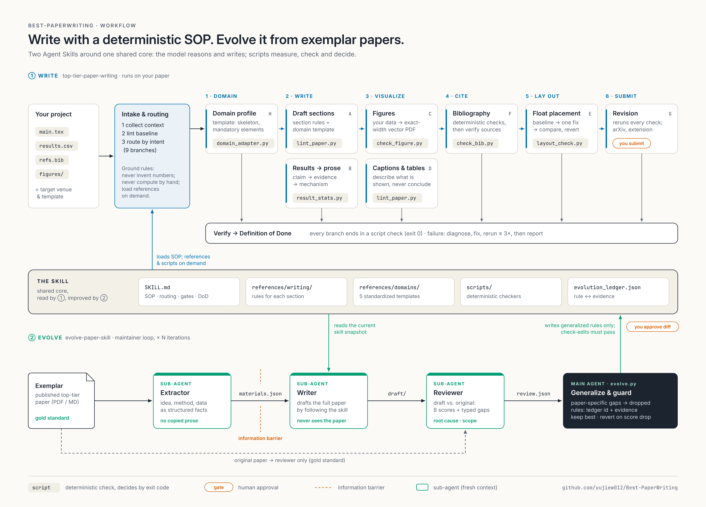

# Best-PaperWriting: An Agent Skill for Top-Tier CS Paper Writing and Academic Figures

[](skills/top-tier-paper-writing/SKILL.md)
[-blue.svg)](https://agentskills.io/specification)
[]()

[中文](README.md) | **English**

`top-tier-paper-writing` is a general-purpose **Agent Skill**: a folder containing `SKILL.md`, scripts and reference material in the open Agent Skills format. **Claude Code, OpenAI Codex and Google Antigravity (app and CLI)** can load it directly.

Written from the perspective of a senior PhD researcher and reviewer with several top-tier publications, it covers the whole life cycle of a computer-science paper for CCF-A conferences and IEEE/ACM Transactions:

1. **Domain templates.** Identify the paper's area (security & privacy, LLM/agent security, federated learning algorithms, systems, NLP/LLM) and apply that area's standardized template: paper skeleton, mandatory elements, evaluation protocol.
2. **Academic figures.** Modern-minimal architecture diagrams with numbered steps ①–⑥, and data plots with the colorblind-safe Okabe-Ito palette at exact single- or double-column widths (3.4 / 6.9 in).
3. **Captions.** Sentence case for figures and Title Case for tables; captions describe, they never conclude.
4. **Prose.** Introductions built on paired challenges, real-world cases and insights; results paragraphs as claim → evidence → mechanism, never reading the table aloud.
5. **Two-column layout.** Three rules for float placement, checked automatically with `floatcheck.sty` + `check_layout.py`.
6. **Self-evolution.** The companion `evolve-paper-skill` improves the skill from exemplar papers with three sub-agents (Extractor → Writer → Reviewer); an evidence ledger prevents overfitting.
7. **Revision and submission.** Backward-consistency pass after new experiments, multi-source bibliography verification, arXiv versions and journal extensions.

See [`skills/top-tier-paper-writing/SKILL.md`](skills/top-tier-paper-writing/SKILL.md) for the full procedure and [`skills/evolve-paper-skill/SKILL.md`](skills/evolve-paper-skill/SKILL.md) for the evolution loop.

<p align="center">
  
</p>

---

## 1. Installation

The repository contains two skills, each kept in a single source folder: `skills/top-tier-paper-writing/` (writing papers) and `skills/evolve-paper-skill/` (evolving the former from exemplar papers; for maintainers). The installer **links** (default) or **copies** them into each agent's skills directory. Use `--skill <name>` to install only one.

```bash
git clone https://github.com/yujiew012/Best-PaperWriting.git
cd Best-PaperWriting
python3 install.py                       # all supported agents, user level
python3 -m pip install -r skills/top-tier-paper-writing/requirements.txt
```

Restart the agent afterwards so it rescans its skills. Common options:

```bash
python3 install.py --agent claude codex          # only some agents
python3 install.py --project /path/to/paper-repo # inside one paper project (can be committed with it)
python3 install.py --copy                        # copy instead of link (e.g. Windows without symlinks)
python3 install.py --dest /any/skills/dir        # any other skills directory
python3 install.py --status                      # show what is installed where
python3 install.py --uninstall                   # remove only what this script installed
```

| Agent | User level (default) | Project level (`--project`) |
| :--- | :--- | :--- |
| Claude Code | `~/.claude/skills/` | `.claude/skills/` |
| OpenAI Codex | `~/.agents/skills/` (older versions read `~/.codex/skills/`; use `--dest`) | `.agents/skills/` |
| Google Antigravity app | `~/.gemini/antigravity/skills/` | `.agents/skills/` |
| Google Antigravity CLI | `~/.gemini/antigravity-cli/skills/` | `.agents/skills/` |

- Symlinks are the default, so every agent shares the same files and `git pull` updates them all. With `--copy`, rerun the installer after updating.
- Directory conventions still change between versions. If yours reads another location, use `--dest`. Confirm the installation inside the agent: `/skills` in Claude Code and Codex, or the Customizations panel in Antigravity.
- **Agents without skill support** (some IDE assistants): `SKILL.md` is plain Markdown. Add a line to the project's `AGENTS.md` or rules file such as "When writing a paper, first read `<path>/top-tier-paper-writing/SKILL.md` and load its references as it instructs."

### Usage

Once installed, just ask the agent for paper work, for example "rewrite the introduction of this paper", "turn this results table into an analysis paragraph" or "check the float placement in main.tex". The agent loads the skill from its description. You can also invoke it explicitly: `/top-tier-paper-writing` in Claude Code, `$top-tier-paper-writing` in Codex.

---

## 2. Design

The skill is an executable SOP, loaded in three layers to keep the agent's context small:

| Layer | Content | Loaded |
| :--- | :--- | :--- |
| 1. Index | `SKILL.md` frontmatter: when to use it, and **when not to** | Always (about 540 characters) |
| 2. SOP | `SKILL.md` body: ground rules, human approval gates, routing table, 9 branches (Read → Do → Verify), failure recovery, Definition of Done | When the skill triggers |
| 3. Resources | `references/` (per-section writing rules, figure / layout / bibliography rules, checker codes) and `assets/` (templates, example data) | When a branch needs them |

**Deterministic work goes to scripts.** Statistics, figure sizes, float positions, labels and references, and bibliography fields are computed and checked by scripts. The model interprets the request, chooses the branch, writes and synthesizes. Every branch ends with a script check as its completion criterion. On failure the agent fixes the issue using `references/lint_rules.md` and reruns the check, at most 3 times per issue, then reports to the user.

**Safety boundaries.** The agent asks before replacing several existing paragraphs, deleting sections, figures or bibliography entries, installing software, or writing to the sentence bank. For submissions, uploads and emails it only prepares the material and never acts on the user's behalf.

## 3. Directory Layout

```
skills/top-tier-paper-writing/
├── SKILL.md                      # trigger description + concise SOP + Definition of Done
├── requirements.txt              # dependencies when not using uv (matplotlib, numpy)
├── EVOLUTION_LOG.md              # evolution history
├── evolution_ledger.json         # rule evidence ledger (maintained by evolve.py; never edit by hand)
├── scripts/                      # deterministic scripts (all with PEP 723 headers, runnable via `uv run`)
│   ├── check_env.py              # environment readiness (plot / layout / bib / lint / network)
│   ├── lint_paper.py             # static .tex checks: labels/refs, caption case and conclusions, \vspace, vague wording, number dumping, abstract/conclusion length
│   ├── result_stats.py           # margins, ranks, ranges, drop rates and "not best" settings from result CSVs
│   ├── plot_data_curves.py       # multi-seed curves (mean ± std, sensitivity optimum, two-phase split)
│   ├── plot_bar_ablation.py      # grouped bars (error bars, difference to the full model)
│   ├── gen_architecture_diagram.py  # architecture diagram from a JSON spec (numbered steps, overlap warnings)
│   ├── pubstyle.py               # shared plot style (sizes, fonts, Okabe-Ito palette)
│   ├── check_figure.py           # figure PDF checks: width, Type 3 fonts, vector output
│   ├── layout_check.py           # one command: diagnostic build + float checks + baseline compare
│   ├── check_layout.py, floatcheck.sty  # float position recording and analysis
│   ├── check_bib.py              # .bib checks: duplicates, missing fields, unbraced acronyms, preprints, missing citations
│   ├── domain_adapter.py         # domain detection and domain profile
│   ├── self_evolve.py            # candidate sentences from exemplar papers (preview; --apply after review)
│   └── validate_skill.py         # maintainers: validate the skill's packaging
├── references/
│   ├── writing/                  # per section: principles & style, abstract/intro, related work/preliminaries, method/theory, evaluation, discussion/conclusion/ethics
│   ├── domains/                  # standardized domain templates (same 8 sections): security_privacy, llm_agent_security, machine_learning_fl, distributed_systems, nlp_llm
│   ├── figures_and_captions.md   # architecture diagrams, data plots, tables, captions, with good/bad examples
│   ├── layout_and_typesetting.md # the three float rules, measurement workflow, repair ladder
│   ├── bibliography.md           # multi-source bibliography verification
│   ├── revision_and_submission.md# backward consistency, arXiv versions, journal extensions
│   ├── domain_and_sentence_mining.md
│   ├── lint_rules.md             # every checker code, its meaning and its fix
│   ├── mechanism_sentence_bank.md, domain_taxonomies.json
│   └── case_lessons_ieee_sp.md, case_lessons_ieee_tcc.md  # lessons from two real submissions
└── assets/
    ├── prompt_templates.md       # prompts: "results table → analysis prose", "architecture diagram design"
    └── curves_example.csv, ablation_example.csv, architecture_example.json  # input format examples (never for papers)
skills/evolve-paper-skill/          # for maintainers: evolves the skill above from exemplar papers
├── SKILL.md                      # orchestrator SOP: iteration loop, sub-agents, approval gates, Definition of Done
├── scripts/evolve.py             # deterministic orchestration: isolated workspaces, validation, leakage checks, scoring, keep/revert, ledger, anti-overfitting guards
├── assets/agents/                # role task templates: extractor.md, writer.md, reviewer.md
├── assets/schemas/               # contracts for materials.json and review.json
└── references/                   # anti_overfitting.md (rule admission ladder), review_rubric.md (8 scoring dimensions)
docs/
├── images/                       # workflow diagram, sponsor codes
└── diagram/                      # code that generates and checks the workflow diagram
```

## 4. Self-Evolution: Improving the Skill from Top-Tier Papers

Give the main agent one or more published top-tier papers. Following the `evolve-paper-skill` SOP, it runs three sub-agents for the number of iterations you choose:

```
            exemplar PDF / Markdown
                   │
        ┌──────────▼──────────┐   outputs structured facts only (idea, method, data, the paper's own names);
        │ ① Extractor          │   copied sentences are detected and rejected (> 16 words)
        └──────────┬──────────┘
          materials.json (title, authors, venue removed)
        ┌──────────▼──────────┐   never sees the paper: its workspace holds only the materials and the
        │ ② Writer             │   current skill; drafts the whole paper + a "skill friction" report
        └──────────┬──────────┘
             draft/main.tex
        ┌──────────▼──────────┐   original = gold standard: 8 scores + a list of gaps, each tagged with
        │ ③ Reviewer           │   a root cause (missing / vague / wrong rule, not followed, …) and a scope
        └──────────┬──────────┘
              review.json
        ┌──────────▼──────────┐   generalize → evolve.py propose (overfitting guard) → edit the skill
        │   Main agent         │   → evolve.py check-edits → next iteration; a score drop reverts automatically
        └─────────────────────┘
```

**Preventing overfitting is the core of the design.** The skill accumulates transferable conventions and never memorizes a specific paper:

| Mechanism | How it works |
| :--- | :--- |
| Domain templates | Knowledge goes into the fixed 8-section structure of `references/domains/<domain>.md`: skeleton, mandatory elements, evaluation protocol, figures, narrative patterns, common rejection reasons, provisional rules. |
| Evidence ladder | One paper can only add a provisional rule to §8 of its domain template. A second paper from the same domain makes it established. Universal rules (`SKILL.md`, `writing/`) need **at least 2 papers from at least 2 domains**. |
| Evidence ledger | `evolution_ledger.json` records each rule's scope and its supporting and contradicting evidence. Rules contradicted more often than supported are retired automatically. |
| Deterministic guards | An edit is refused if it contains the paper's method or component names, its result values, or 8 or more consecutive words from it. At most 40 added lines per iteration and 8 provisional rules per paper. Every added rule line must carry its ledger id. |
| Information barrier | The Writer never sees the original. A draft with too much verbatim overlap with the original is invalid. |
| Keep the best | The skill is snapshotted every iteration. If a new draft scores below the best earlier one (tolerance 0.25), the edits are reverted and their rules rejected. |
| Holdout check | Earlier exemplars (cached materials) confirm that new edits did not make older papers worse. |
| Human approval | You confirm the papers and the number of iterations up front, then review `report.md` and the `git diff` to keep the changes or `revert --to-base`. |

Usage: tell the agent "evolve the paper-writing skill with these papers, 3 iterations", and it loads `evolve-paper-skill` and follows the procedure. Paper text, materials and drafts stay in `.evolution/` (git-ignored) and never enter the repository.

## 5. Script Quick Reference

The agent calls these scripts as the SOP prescribes, but you can also run them yourself. `uv run` is recommended: it prepares an isolated environment from each script's header. Without uv, use `python3` after `pip install -r requirements.txt`.

```bash
S=skills/top-tier-paper-writing/scripts

python3 $S/check_env.py                                          # environment check
uv run $S/lint_paper.py paper/main.tex                           # static manuscript checks
uv run $S/result_stats.py --data results.csv --ours "FedPE"      # evidence numbers before writing the analysis
uv run $S/plot_data_curves.py --data curves.csv --ours "FedPE (Ours)" \
    --xlabel "Communication rounds" --ylabel "Test accuracy (%)" --out fig_conv.pdf
uv run $S/plot_bar_ablation.py --data ablation.csv --ours "Full model" --annotate-delta --out fig_abl.pdf
uv run $S/gen_architecture_diagram.py --spec fig_arch.json --out fig_arch.pdf
uv run $S/check_figure.py fig_*.pdf                              # width / font checks
uv run $S/layout_check.py paper/main.tex --save-baseline before.json   # before editing
uv run $S/layout_check.py paper/main.tex --compare before.json         # after editing: exit 1 if worse
uv run $S/check_bib.py paper/refs.bib --tex paper/main.tex
```

All checkers use the same exit codes: 0 = pass, 1 = problems found, 2 = input or environment error. `--json` writes a machine-readable report.

---

## 6. Maintenance

- Edit only the source folders under `skills/`. With symlink installs, that is exactly what every agent reads.
- After changes, run `python3 skills/top-tier-paper-writing/scripts/validate_skill.py`. It checks:
  - the frontmatter: `name` equals the folder name; `description` is a single line of at most 1024 characters;
  - every path mentioned in `SKILL.md` exists;
  - every script has a PEP 723 header and compiles;
  - no file in `references/` or `assets/` is unreachable from `SKILL.md`.
- Keep `SKILL.md` to procedure, rules and the Definition of Done (under 500 lines). Put detail into `references/` and register it in the matching branch's **Read** step.
- New deterministic checks become scripts in `scripts/` (PEP 723 header, `--json`, standard exit codes), and their codes go into `references/lint_rules.md`.
- The workflow diagram is generated from code. After editing `docs/diagram/build_workflow.py`, run `python3 docs/diagram/build_workflow.py && node docs/diagram/render.js`. The renderer exports `docs/images/workflow.png` at 3× resolution and verifies that no text overflows and no elements overlap; it exits 1 otherwise.

---

## 7. Feed the Stray Cats 🐱

If this skill saved you a few late nights of revisions, you can scan either code below to buy a meal for stray cats. **All sponsorship goes to cat food for stray cats.**

<div align="center">
<table>
  <tr>
    <td align="center" width="260"></td>
    <td align="center" width="260"></td>
  </tr>
  <tr>
    <td align="center"><b>WeChat Pay</b></td>
    <td align="center"><b>WeChat Reward</b></td>
  </tr>
</table>
</div>

<p align="center">Thank you, from us and from the cats!</p>
